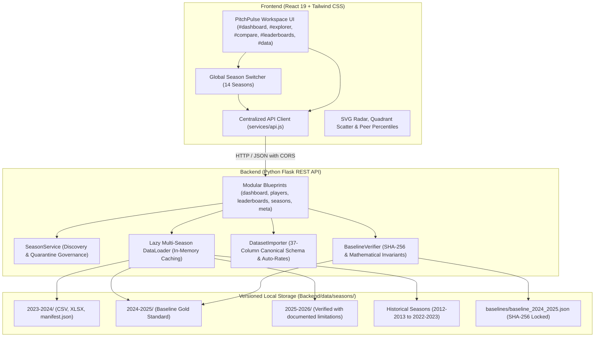

# PitchPulse Analytics — European Football Intelligence Platform

[](https://react.dev/)
[](https://tailwindcss.com/)
[](https://flask.palletsprojects.com/)
[](https://pandas.pydata.org/)
[-10b981)](#-multi-season-registry)
[](#-testing-suite)

PitchPulse is a modern, full-stack European football analytics platform and scouting workspace covering **Europe's Top 5 Leagues** (Premier League, La Liga, Serie A, Bundesliga, and Ligue 1) across **14 distinct seasons** (`2012/13` through `2025/26`). Built with a **React 19** frontend and a **Python / Flask / pandas** backend, it transforms raw match events into actionable scouting intelligence, interactive quadrant matrices, multi-axis radar charts, empirical peer percentiles, and versioned multi-season analytics.

---

## 🌟 Key Features

### 1. 📊 European Football Intelligence Dashboard
- **Global & Competition-Level KPIs**: Cumulative totals for goals, assists, expected goals ($xG$), expected assisted goals ($xAG$), and European finishing differential ($Goals - xG$).
- **Finishing Efficiency Matrix**: Visual analysis of the continent's sharpest overperformers and underperformers relative to shot quality (min 500 mins qualifier).
- **Attacking Threat Quadrant Matrix**: 2D scatter matrix mapping expected goals ($xG$) vs expected assisted goals ($xAG$) into Elite Dual Threats, Primary Scorers, Creators, and Role Players.
- **Ball Progression Matrix**: Progressive carries ($PrgC$) versus progressive passes ($PrgP$) isolating transition ball carriers and progressive distributors.
- **Standout Leaders**: Live top scorers and creators with direct profile navigation.

### 2. 🔍 Advanced Player Explorer
- **Comprehensive Database**: Season-selectable player records across Europe's top five leagues; row and club counts vary by season.
- **Multi-Parameter Search & Filter**: Filter simultaneously by player name, club, competition, primary position (`FW`, `MF`, `DF`, `GK`), and minimum minutes.
- **Per-90 Rate Normalization Toggle**: One-click switch between season volume totals (e.g. 15 goals) and standardized per-90 rates (e.g. 0.72 goals/90) for fair sub/starter comparison.
- **Server-Side Pagination & Sorting**: Fast column sorting on any offensive, creation, progression, or defensive metric.

### 3. 👤 Dedicated Player Scouting Dossiers (`PlayerProfileView`)
- **Player Identity & Demographics**: Squad crests, national flags, birth year, age, and competition badges.
- **Positional Peer Percentiles**: Empirical percentile ranks (0–100th) calculated dynamically against positional peers across Europe with $\ge 270$ minutes.
- **8 Core Scouting Benchmarks**: Goals/90, $xG$/90, Assists/90, $xAG$/90, Progressive Carries, Progressive Passes, Progressive Receptions, and Finishing Differential.
- **Standardized Per-90 Metric Breakdown**: Rate cards for shot quality, creation, and disciplinary record.

### 4. ⚔️ Head-to-Head Comparison Workspace
- **Multi-Player Benchmarking**: Compare up to 5 players side-by-side with color-coded tracking.
- **SVG Multi-Axis Scouting Radar**: Interactive radar polygon chart with 5 concentric percentage rings (20% to 100%), hover tooltips, and empirical peer percentile scoring.
- **Categorized Benchmark Matrix**: Grouped by Rates, Expected Values, Finishing Differentials, Progression, Volume, and Discipline.
- **Category Leader Identification**: Automatic detection of top performers per metric marked with green highlight badges and leader stars (`★`).

### 5. 🏆 Statistical Leaderboards Hub (`LeaderboardsView`)
- **10 Core Metric Categories**: Top Scorers (`Gls`), Expected Goals (`xG`), Finishing Overperformance (`Gls - xG`), Assists (`Ast`), Expected Assists (`xAG`), Progressive Carries (`PrgC`), Progressive Passes (`PrgP`), Goals/90 (`Gls_90`), Assists/90 (`Ast_90`), and Minutes (`Min`).
- **Podium Display**: Gold, Silver, and Bronze podium cards for ranks 1–3 with crown indicators.
- **Multi-Tier Filtering**: Filter leaderboards by competition, position, and minutes thresholds (270+, 500+, 900+).

### 6. 🌐 Multi-Season Architecture & Global Season Switcher
- **Instant Cross-Season Browsing**: Global dropdown in the top navbar allows instant switching between all 14 registered seasons (`2012/13` to `2025/26`).
- **Zero-Latency In-Memory Caching**: Lazy season cache loads normalized CSV files with sub-millisecond API responses.
- **Isolated Storage**: Dedicated directories per season (`Backend/data/seasons/<season>/`) with individual `manifest.json` metadata files ensuring historical seasons are never mutated or overwritten.
- **Reference Baseline Invariants**: The 2024/25 reference dataset is cryptographically locked via SHA-256 (`b6adc0f2...` CSV, `7dbea8fd...` XLSX) and statistically anchored (2,854 players, 4,806 goals, 3,429 assists).

### 7. 📥 Automated Ingestion Pipeline & Dataset Registry (`#data`)
- **Direct File Ingestion**: Secure multipart file uploads with strict format verification (`.csv`, `.xlsx`, `.xls`).
- **Risk-Free Dry-Run Validation**: Test candidate datasets against the 37 canonical columns without touching disk storage.
- **Automatic Column Normalization**: Automatically maps 50+ header aliases (e.g. `Goals` $\rightarrow$ `Gls`, `Expected Goals` $\rightarrow$ `xG`, `Assists` $\rightarrow$ `Ast`).
- **Deterministic Rate Auto-Derivation**: Automatically derives missing `90s`, compound stats (`G+A`, `G-PK`, `npxG+xAG`), and all 10 per-90 rates from raw counts.
- **Security Hardening**: Protected by admin authentication, strict season identifier validation, path containment, and automated atomic writes.

### 8. 📈 Scatter plot comparison
- Scatter plots use metric-aware domains, median guide lines, and tooltips limited to the selected metrics, minutes, club, position, competition, and goals minus xG (shown as n/a when unavailable).
- The labelled toolbar supports filters, per-90 display, colour and size encodings, overlap reduction, quadrant labels, and a reset action.
- **Compare seasons: lock scale** is off by default. Enabling it sets `lock=1` in the plot URL and uses `/api/charts/scatter/range` to calculate shared bounds across seasons with tracked values; if that request fails, the chart stays on its season-specific scale.
- See [Scatter plot behavior and maintenance](docs/SCATTER_AND_QUALITY_PLAN.md) for details.

---

## 🗄 Multi-Season Registry & Historical Eras

PitchPulse organizes 14 historical seasons into clearly governed statistical eras:

| Era | Seasons | Clubs | Top Scorer Highlight | Era Metrics | Governance Status |
| :--- | :---: | :---: | :--- | :--- | :---: |
| **Pre-xG Era** | `2012/13` – `2013/14` | 98 | Lionel Messi (`12/13`: 46 Gls) • Luis Suárez (`13/14`: 31 Gls) | Standard stats, minutes, cards; advanced metrics untracked (`NaN`) | **Historical; coverage gaps flagged** |
| **Early xG Era** | `2014/15` – `2016/17` | 98 | Cristiano Ronaldo (`14/15`: 48 Gls) • Luis Suárez (`15/16`: 40 Gls) | Standard stats + Understat $xG$, $npxG$; progression untracked | **Historical; coverage gaps flagged** |
| **Modern Event Era** | `2017/18` – `2023/24` | 98 / 96 | **Harry Kane** (`23/24`: 36 Gls, Golden Shoe) • Mbappé (27 Gls) • Haaland (27 Gls) | Complete 37 canonical metrics including progressive passes & carries | **Historical; coverage gaps flagged** |
| **Reference Baseline** | `2024/25` | 96 | Kylian Mbappé (31 Gls) • Mohamed Salah (29 Gls) • Lewandowski (27 Gls) | Gold standard baseline: SHA-256 fingerprinted, 4,806 goals, 3,429 assists | **Authoritative Baseline (Locked)** |
| **2025/26 Composite** | `2025/26` | 172 distinct raw labels after Phase 2 | Harry Kane (36 Gls) • Erling Haaland (27 Gls) | Historical aggregates with partial-season league snapshots; progression fields unavailable and represented as null; 386 zero-minute placeholders archived; squad verification is maintained in a sidecar | **Verified with documented limitations** |

### Historical completeness flags

The read-only Wikipedia cross-check grades below flag coverage gaps without changing any player data. Historical datasets are not uniformly complete: 12 of the 14 listed seasons have measurable real gaps under the documented club thresholds. `known_gaps.json` sidecars contain the club and top-scorer details for MINOR_GAPS and SIGNIFICANT_GAPS seasons; season-specific grades below qualify the era labels above.

| Season | Gap grade | Note |
|---|---|---|
| 2012/13 | MINOR_GAPS | Small club-level shortfalls. |
| 2013/14 | MINOR_GAPS | Small club-level shortfalls. |
| 2014/15 | SIGNIFICANT_GAPS | Large pre-existing gaps, especially Burnley, Atlético Madrid and Villarreal. |
| 2015/16 | MINOR_GAPS | Small club-level shortfalls. |
| 2016/17 | MINOR_GAPS | Small club-level shortfalls. |
| 2017/18 | MINOR_GAPS | Small club-level shortfalls. |
| 2018/19 | MINOR_GAPS | Small club-level shortfalls. |
| 2019/20 | MINOR_GAPS | Small club-level shortfalls. |
| 2020/21 | SIGNIFICANT_GAPS | Large pre-existing gaps, including Real Madrid attacking coverage. |
| 2021/22 | MINOR_GAPS | Small club-level shortfalls. |
| 2022/23 | COMPLETE | No club crossed the real-gap threshold. |
| 2023/24 | MINOR_GAPS | Small club-level shortfalls. |
| 2024/25 | MINOR_GAPS | Flag recorded in the investigation; the locked baseline files and manifest were not changed. |
| 2025/26 | PARTIAL_SNAPSHOT | Serie A and Ligue 1 are incomplete snapshots; full-league checks cover the other three leagues. |

*For full cryptographic hashes, mathematical totals, and licensing provenance, see [Data Sources](docs/DATA_SOURCES.md), [Terms](docs/TERMS.md), and the [historical gap report](docs/OLD_SEASON_GAPS.md).*

---

## 🏗 System Architecture



---

## 🧪 Testing Suite

The application includes automated unit and integration tests across both backend and frontend:

```bash
# Install pinned backend runtime and test dependencies
python -m pip install -r Backend/requirements-dev.txt

# Run the full backend test suite
python -m pytest Backend/tests

# Run cryptographic baseline invariant verification
python Backend/test_api_baseline.py

# Check CSV, XLSX, Parquet, and DuckDB row-level parity without writing data
python Backend/scripts/check_storage_parity.py
python Backend/scripts/check_storage_parity.py --season 2025-2026

# Run the frontend test suite
cd frontend && npm test -- --watchAll=false
```

The parity audit is read-only and returns a failure code when stores differ. It currently identifies historical zero-versus-null representation differences for 2012/13–2022/23; see [Data Sources](docs/DATA_SOURCES.md) before interpreting those results.

CI runs parity checks for the locked 2024/25 baseline and repaired 2025/26 season. Python and production JavaScript dependency audits are advisory so upstream advisories do not conceal test or build failures. Frontend lint errors are blocking.

### Deployment notes

Vercel packaging intentionally excludes Markdown documentation, tests, maintenance scripts, XLSX files, and local audit artifacts. CI still checks out and runs repository tests and scripts. The deployed Flask app reads season CSV and JSON metadata, both of which are included in `Backend/vercel.json`; XLSX files are downloadable source artifacts, not runtime inputs. Set `CORS_ORIGINS` to the deployed frontend origin(s) in production. Local development and isolated tests retain wildcard CORS; a production process with an unset or wildcard value restricts origins to the local development list and logs a warning.

---

## 📄 Licensing & Data Attribution

- **Software License**: The PitchPulse Analytics application code is released under the [MIT License](LICENSE).
- **Sports Data Attribution**: Player statistics, match records, and advanced event metrics are derived from public sports reporting archives (FBref, Opta/Stats Perform, and Understat). All trademarks and underlying proprietary feeds belong to their respective rights holders. Detailed provider terms and data provenance are documented in [docs/DATA_SOURCES.md](docs/DATA_SOURCES.md).
