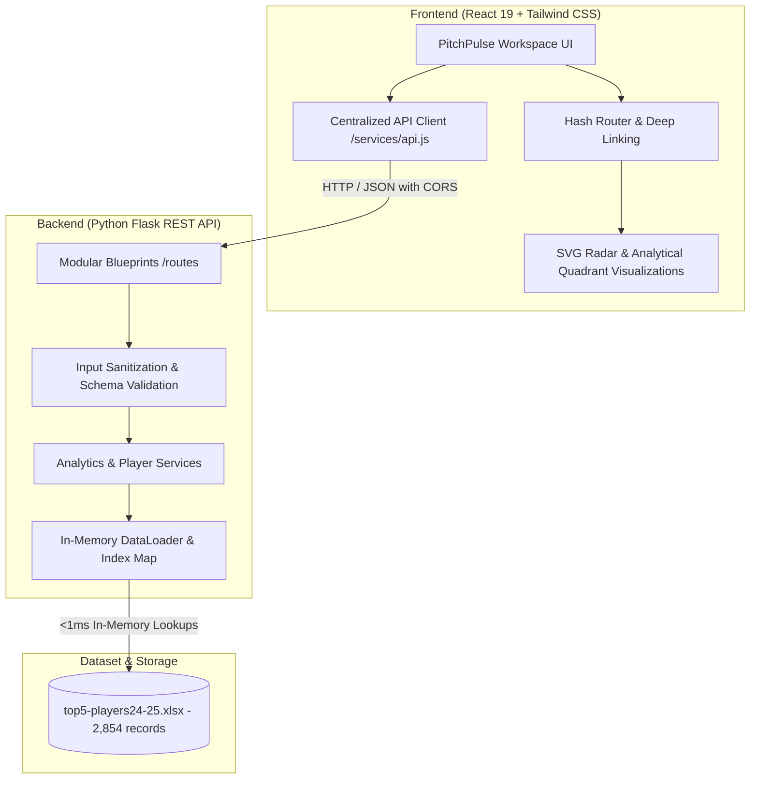

# PitchPulse Analytics — European Football Intelligence Platform

[](https://react.dev/)
[](https://tailwindcss.com/)
[](https://flask.palletsprojects.com/)
[](https://pandas.pydata.org/)
[](https://fbref.com/)
[-emerald)](#testing-suite)

PitchPulse is a modern football analytics platform and scouting dashboard covering **Europe's Top 5 Leagues** (Premier League, La Liga, Serie A, Bundesliga, and Ligue 1) for the **2024/25 regular season**. Built with a **React 19** frontend and a **Python / Flask / pandas** backend, it transforms static match statistics into actionable scouting intelligence, interactive quadrant matrices, multi-axis radar charts, and head-to-head performance benchmarks.

---

## 🌟 Key Features

### 1. 📊 European Football Intelligence Dashboard
- **Global & Competition-Level KPIs**: Instant cumulative totals for goals, assists, expected goals ($xG$), expected assisted goals ($xAG$), and European finishing differential ($Goals - xG$).
- **Finishing Efficiency Matrix**: Visual analysis of the continent's sharpest overperformers and underperformers relative to shot quality (min 500 mins qualifier).
- **Attacking Threat Quadrant Matrix**: 2D scatter matrix mapping expected goals ($xG$) vs expected assisted goals ($xAG$) into Elite Dual Threats, Primary Scorers, Creators, and Role Players.
- **Ball Progression Matrix**: Progressive carries ($PrgC$) versus progressive passes ($PrgP$) isolating transition ball carriers and progressive distributors.
- **Standout Leaders**: Live top scorers and creators with direct profile navigation.

### 2. 🔍 Advanced Player Explorer
- **Comprehensive Database**: Full dataset of **2,854 player records** across **96 clubs**.
- **Multi-Parameter Search & Filter**: Filter simultaneously by player name, club, competition, primary position (`FW`, `MF`, `DF`, `GK`), and minimum minutes.
- **Per-90 Rate Normalization Toggle**: One-click switch between season volume totals (e.g. 15 goals) and standardized per-90 rates (e.g. 0.72 goals/90) for fair sub/starter comparison.
- **Server-Side Pagination & Sorting**: Fast column sorting on any offensive or defensive metric.

### 3. 👤 Dedicated Player Scouting Dossiers (`PlayerProfileView`)
- **Player Identity & Demographics**: Squad crests, national flags, birth year, age, and competition badges.
- **Positional Peer Percentiles**: Empirical percentile ranks (0–100th) calculated dynamically against positional peers across Europe with $\ge 270$ minutes.
- **8 Core Scouting Benchmarks**: Goals/90, $xG$/90, Assists/90, $xAG$/90, Progressive Carries, Progressive Passes, Progressive Receptions, and Finishing Differential.
- **Standardized Per-90 Metric Breakdown**: Rate cards for shot quality, creation, and disciplinary record.

### 4. ⚔️ Head-to-Head Comparison Workspace
- **Multi-Player Benchmarking**: Compare up to 5 players side-by-side with color-coded tracking.
- **SVG Multi-Axis Scouting Radar**: Interactive radar polygon chart with 5 concentric percentage rings (20% to 100%), hover tooltips, and empirical peer percentile scoring.
- **Categorized Benchmark Matrix**: Grouped by Rates, Expected Values, Finishing Differentials, Progression, Volume, and Discipline.
- **Category Leader Identification**: Automatic detection of top performers per metric marked with green highlight badges and leader stars (`★`).

### 5. 🏆 Statistical Leaderboards Hub (`LeaderboardsView`)
- **10 Core Metric Categories**: Top Scorers (`Gls`), Expected Goals (`xG`), Finishing Overperformance (`Gls - xG`), Assists (`Ast`), Expected Assists (`xAG`), Progressive Carries (`PrgC`), Progressive Passes (`PrgP`), Goals/90 (`Gls_90`), Assists/90 (`Ast_90`), and Minutes (`Min`).
- **Podium Display**: Gold, Silver, and Bronze podium cards for ranks 1–3 with crown indicators.
- **Multi-Tier Filtering**: Filter leaderboards by competition, position, and minutes thresholds (270+, 500+, 900+).

### 6. 🗃 Modernized Classic Squad Browser
- Interactive 3D flip-card squad browser maintained for backward compatibility, with modernized dark pitch styling.

---

## 🏗 System Architecture



### Performance & Data Design
- **In-Memory Caching**: The original 1.250-second disk-read latency per request was reduced to **<1 millisecond** (>500x speedup) via a preloaded singleton `DataLoader` initialized during server boot.
- **Transfer Handling**: Multi-club transfer spells in the same season (304 occurrences) are cleanly distinguished by separating unique integer `record_id` / `id` from canonical `player_slug`.
- **Environment Isolation**: The frontend uses configurable `REACT_APP_API_URL` environment variables with automatic fallback to local development proxies.

---

## 📡 REST API Reference

| Method | Endpoint | Description | Query Parameters |
|---|---|---|---|
| `GET` | `/api/health` | Health check & dataset readiness status | None |
| `GET` | `/api/metadata` | Season, records, clubs, and schema metadata | None |
| `GET` | `/api/competitions` | List of 5 European competitions with club counts | None |
| `GET` | `/api/dashboard` | Aggregated European KPIs, scatter data, & leaders | `competition` (optional) |
| `GET` | `/api/players` | Searchable & paginated player database | `query`, `competition`, `position`, `min_minutes`, `sort_by`, `order`, `page`, `limit` |
| `GET` | `/api/players/<id>` | Full player dossier with positional percentiles | None |
| `POST` | `/api/players/compare` | Head-to-head comparison matrix & radar scores | JSON: `{"player_ids": [1, 2, ...]}` (max 5) |
| `GET` | `/api/leaderboards` | Top player rankings across 10 metric categories | `metric`, `competition`, `position`, `min_minutes`, `limit` |
| `GET` | `/api/teams` | List of clubs optionally filtered by competition | `competition` (optional) |
| `GET` | `/api/metrics` | Data dictionary of all 37 statistical columns | None |

---

## 🚀 Getting Started

### Prerequisites
- **Node.js**: v18.0.0 or higher
- **npm**: v9.0.0 or higher
- **Python**: v3.10, v3.11, v3.12, or v3.13

### 1. Clone & Setup Workspace
```bash
git clone https://github.com/rk0802p/sports-analytics.git
cd sports-analytics
```

### 2. Backend Setup
```bash
cd Backend

# Create and activate virtual environment
python -m venv venv
# On Windows PowerShell:
.\venv\Scripts\activate
# On macOS / Linux:
source venv/bin/activate

# Install dependencies
pip install -r requirements.txt

# Run the Flask backend server (port 5000)
python api.py
```
The API server will initialize the dataset and be accessible at `http://127.0.0.1:5000/api`.

### 3. Frontend Setup
In a new terminal window:
```bash
cd frontend

# Install dependencies
npm install

# Start development server
npm start
```
The application will launch at `http://localhost:3000`.

---

## 🧪 Testing Suite

The project includes an end-to-end automated test suite spanning backend unit tests, baseline API contracts, performance benchmarks, and React component tests.

### Backend Tests (41 Tests)
```bash
# Run modular backend test suite (28 tests)
.\Backend\venv\Scripts\python.exe -m unittest discover -s Backend/tests -p "test_*.py"

# Run baseline integration & contract tests (13 tests)
.\Backend\venv\Scripts\python.exe -m unittest Backend/test_api_baseline.py
```

### Frontend Tests (9 Tests)
```bash
cd frontend
npm test -- --watchAll=false
```

### Production Build Verification
```bash
cd frontend
npm run build
```
Creates an optimized, tree-shaken production bundle (`build/`) with zero warnings or errors.

---

## 📁 Repository Directory Structure

```text
sports-analytics/
├── .env.example                       # Root environment templates
├── README.md                          # Project documentation
├── Backend/
│   ├── api.py                         # Flask application entry point
│   ├── config.py                      # Competitions, lookup dictionaries, metadata
│   ├── requirements.txt               # Pinned Python dependencies
│   ├── top5-players24-25.xlsx         # FBref 2024/25 player dataset (2,854 rows)
│   ├── routes/                        # Modular Flask blueprints
│   │   ├── dashboard.py               # Aggregated KPIs and quadrant data
│   │   ├── players.py                 # Explorer, dossiers, comparisons
│   │   ├── leaderboards.py            # Ranked leaderboards
│   │   └── meta.py                    # Health, metadata, competitions
│   ├── schemas/                       # Response envelopes and formatting
│   ├── services/                      # Core business logic
│   │   ├── data_loader.py             # In-memory cached dataset singleton
│   │   ├── player_service.py          # Positional percentiles & dossiers
│   │   ├── analytics_service.py       # Comparison matrix, radar, leaderboards
│   │   └── validation_service.py      # Input validation & competition aliases
│   └── tests/                         # Comprehensive unittest suite
└── frontend/
    ├── package.json                   # React 19 & Tailwind CSS v3 dependencies
    ├── tailwind.config.js             # Pitch theme colors, badges, typography
    ├── src/
    │   ├── App.js                     # Main application layout and view router
    │   ├── App.test.js                # React testing-library suite
    │   ├── services/
    │   │   └── api.js                 # Centralized HTTP client
    │   └── components/
    │       ├── layout/AppLayout.js    # Sidebar, top navigation, status indicator
    │       ├── common/                # StatCard, FilterBar, DataTable, Badges
    │       ├── dashboard/             # FinishingEfficiency, AttackingScatter, Progression
    │       ├── profile/               # PlayerProfileView (Dossiers & Percentiles)
    │       ├── compare/               # ComparisonRadarChart, ComparisonMatrix
    │       └── leaderboards/          # LeaderboardsView (Podiums & Rankings)
```

---

## 📊 Dataset Attribution & Disclaimer

The statistics in this project are based on player-level match aggregates from the **2024/25 European regular season** across England's Premier League, Spain's La Liga, Italy's Serie A, Germany's Bundesliga, and France's Ligue 1. Data aligns with standard FBref and Opta definitions (Expected Goals $xG$, Expected Assisted Goals $xAG$, Progressive Carries $PrgC$, Progressive Passes $PrgP$).

---

## 📄 License

This project is licensed under the MIT License — see the [LICENSE](LICENSE) file for details.
