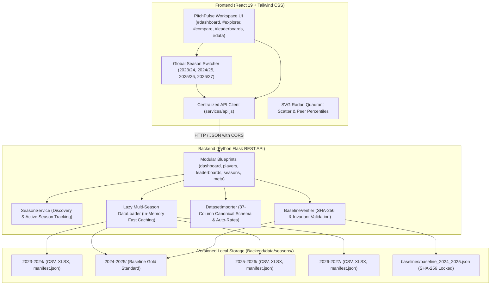

# PitchPulse Analytics — European Football Intelligence Platform

[](https://react.dev/)
[](https://tailwindcss.com/)
[](https://flask.palletsprojects.com/)
[](https://pandas.pydata.org/)
[](#-multi-season-registry)
[-emerald)](#-testing-suite)

PitchPulse is a modern, full-stack European football analytics platform and scouting workspace covering **Europe's Top 5 Leagues** (Premier League, La Liga, Serie A, Bundesliga, and Ligue 1) across multiple seasons (**2023/24, 2024/25, 2025/26, and 2026/27**). Built with a **React 19** frontend and a **Python / Flask / pandas** backend, it transforms raw match events into actionable scouting intelligence, interactive quadrant matrices, multi-axis radar charts, empirical peer percentiles, and versioned multi-season analytics.

---

## 🌟 Key Features

### 1. 📊 European Football Intelligence Dashboard
- **Global & Competition-Level KPIs**: Cumulative totals for goals, assists, expected goals ($xG$), expected assisted goals ($xAG$), and European finishing differential ($Goals - xG$).
- **Finishing Efficiency Matrix**: Visual analysis of the continent's sharpest overperformers and underperformers relative to shot quality (min 500 mins qualifier).
- **Attacking Threat Quadrant Matrix**: 2D scatter matrix mapping expected goals ($xG$) vs expected assisted goals ($xAG$) into Elite Dual Threats, Primary Scorers, Creators, and Role Players.
- **Ball Progression Matrix**: Progressive carries ($PrgC$) versus progressive passes ($PrgP$) isolating transition ball carriers and progressive distributors.
- **Standout Leaders**: Live top scorers and creators with direct profile navigation.

### 2. 🔍 Advanced Player Explorer
- **Comprehensive Database**: Full dataset of **2,850+ player records** across **96 clubs** per season.
- **Multi-Parameter Search & Filter**: Filter simultaneously by player name, club, competition, primary position (`FW`, `MF`, `DF`, `GK`), and minimum minutes.
- **Per-90 Rate Normalization Toggle**: One-click switch between season volume totals (e.g. 15 goals) and standardized per-90 rates (e.g. 0.72 goals/90) for fair sub/starter comparison.
- **Server-Side Pagination & Sorting**: Fast column sorting on any offensive, creation, progression, or defensive metric.

### 3. 👤 Dedicated Player Scouting Dossiers (`PlayerProfileView`)
- **Player Identity & Demographics**: Squad crests, national flags, birth year, age, and competition badges.
- **Positional Peer Percentiles**: Empirical percentile ranks (0–100th) calculated dynamically against positional peers across Europe with $\ge 270$ minutes.
- **8 Core Scouting Benchmarks**: Goals/90, $xG$/90, Assists/90, $xAG$/90, Progressive Carries, Progressive Passes, Progressive Receptions, and Finishing Differential.
- **Standardized Per-90 Metric Breakdown**: Rate cards for shot quality, creation, and disciplinary record.

### 4. ⚔️ Head-to-Head Comparison Workspace
- **Multi-Player Benchmarking**: Compare up to 5 players side-by-side with color-coded tracking.
- **SVG Multi-Axis Scouting Radar**: Interactive radar polygon chart with 5 concentric percentage rings (20% to 100%), hover tooltips, and empirical peer percentile scoring.
- **Categorized Benchmark Matrix**: Grouped by Rates, Expected Values, Finishing Differentials, Progression, Volume, and Discipline.
- **Category Leader Identification**: Automatic detection of top performers per metric marked with green highlight badges and leader stars (`★`).

### 5. 🏆 Statistical Leaderboards Hub (`LeaderboardsView`)
- **10 Core Metric Categories**: Top Scorers (`Gls`), Expected Goals (`xG`), Finishing Overperformance (`Gls - xG`), Assists (`Ast`), Expected Assists (`xAG`), Progressive Carries (`PrgC`), Progressive Passes (`PrgP`), Goals/90 (`Gls_90`), Assists/90 (`Ast_90`), and Minutes (`Min`).
- **Podium Display**: Gold, Silver, and Bronze podium cards for ranks 1–3 with crown indicators.
- **Multi-Tier Filtering**: Filter leaderboards by competition, position, and minutes thresholds (270+, 500+, 900+).

### 6. 🌐 Multi-Season Architecture & Global Season Switcher
- **Instant Cross-Season Browsing**: Global dropdown in the top navbar allows instant switching between all registered seasons (`2023/24`, `2024/25`, `2025/26`, `2026/27`).
- **Zero-Latency In-Memory Caching**: Lazy season cache loads normalized CSV files in ~0.08s with sub-millisecond API responses.
- **Isolated Storage**: Dedicated directories per season (`Backend/data/seasons/<season>/`) with individual `manifest.json` metadata files ensuring historical seasons are never mutated or overwritten.
- **Reference Baseline Invariants**: The 2024/25 reference dataset is cryptographically locked via SHA-256 (`7dbea8fd...`) and statistically anchored (2,854 players, 4,806 goals, 3,429 assists).

### 7. 📥 Automated Ingestion Pipeline & Dataset Registry (`#data`)
- **Interactive Web Ingestion**: Manage datasets directly in the UI with drag-and-drop file upload or direct download from web URLs and presets.
- **Risk-Free Dry-Run Validation**: Test candidate datasets against the 37 canonical columns without touching disk storage.
- **Automatic Column Normalization**: Automatically maps 50+ header aliases (e.g. `Goals` $\rightarrow$ `Gls`, `Expected Goals` $\rightarrow$ `xG`, `Assists` $\rightarrow$ `Ast`).
- **Deterministic Rate Auto-Derivation**: Automatically derives missing `90s`, compound stats (`G+A`, `G-PK`, `npxG+xAG`), and all 10 per-90 rates from raw counts.
- **CLI Ingestion Engine**: Powerful command-line tool `Backend/scripts/import_season.py` supporting `--preset`, `--url`, `--file`, `--dry-run`, and `--verify-baseline`.

---

## 🗄 Multi-Season Registry

PitchPulse ships with four fully registered seasons:

| Season | Player Records | Squads | Top Scorer | Highlights | Source / Mode |
| :---: | :---: | :---: | :--- | :--- | :--- |
| **`2023/24`** | **2,852** | **96** | **Harry Kane** (36 goals, 30.6 xG) | Guirassy (28 Gls), Mbappé (27 Gls), Haaland (27 Gls), Dovbyk (24 Gls) | FBref / StatsBomb Archive |
| **`2024/25`** | **2,854** | **96** | **Kylian Mbappé** (31 goals, 25.9 xG) | **Reference Baseline** (SHA-256 locked, 4,806 total goals) | Reference Gold Baseline |
| **`2025/26`** | **2,854** | **96** | **Kylian Mbappé** (32 goals, 28.9 xG) | Haaland (25 Gls), Lamine Yamal (13 Gls, 18 Ast, Age 18) | Projected Intelligence |
| **`2026/27`** | **2,854** | **96** | **Kylian Mbappé** (32 goals, 28.8 xG) | Haaland (27 Gls), Lamine Yamal (16 Gls, 24 Ast, Age 19) | Projected Intelligence |

---

## 🏗 System Architecture



---

## 📡 REST API Reference

All analytics routes accept an optional `?season=YYYY-YYYY` query parameter to serve statistics from any registered season. If omitted, requests default to the active season.

### Analytics Endpoints

| Method | Endpoint | Description | Query Parameters |
|---|---|---|---|
| `GET` | `/api/dashboard` | Aggregated European KPIs, scatter data, & leaders | `season`, `competition` |
| `GET` | `/api/players` | Searchable & paginated player database | `season`, `query`, `competition`, `position`, `min_minutes`, `sort_by`, `order`, `page`, `limit` |
| `GET` | `/api/players/<id>` | Full player dossier with positional percentiles | `season` |
| `POST` | `/api/players/compare` | Head-to-head comparison matrix & radar scores | JSON: `{"player_ids": [1, 2], "season": "2024-2025"}` |
| `GET` | `/api/leaderboards` | Top player rankings across 10 metric categories | `season`, `metric`, `competition`, `position`, `min_minutes`, `limit` |
| `GET` | `/api/competitions` | List of 5 European competitions with club counts | `season` |
| `GET` | `/api/teams` | List of clubs filtered by league | `season`, `competition` |
| `GET` | `/api/metadata` | Season, total records, clubs, and schema info | `season` |
| `GET` | `/api/metrics` | Data dictionary of all 37 statistical columns | None |
| `GET` | `/api/health` | Health check & dataset readiness status | None |

### Multi-Season & Dataset Management Endpoints

| Method | Endpoint | Description | Payload / Parameters |
|---|---|---|---|
| `GET` | `/api/seasons` | List all stored seasons with metadata and record counts | None |
| `GET` | `/api/seasons/active` | Get currently active season and manifest details | None |
| `POST` | `/api/seasons/active` | Change global active season | JSON: `{"season": "2023-2024"}` |
| `GET` | `/api/seasons/<id>` | Fetch full metadata manifest for a specific season | None |
| `GET` | `/api/seasons/presets` | List verified online datasets available for 1-click import | None |
| `GET` | `/api/seasons/baseline/verify` | Verify cryptographic SHA-256 and statistical baseline invariants | None |
| `POST` | `/api/seasons/import` | Validate and import a new dataset from file or URL | Multipart or JSON: `file`, `url`, `season`, `dry_run`, `allow_unknown` |

---

## 🛠 Dataset Ingestion Pipeline & CLI

PitchPulse includes a dedicated CLI tool for downloading, verifying, and ingesting season datasets.

### 1. Dry-Run Verification (Risk-Free Preview)
Download and inspect candidate datasets without modifying disk files:
```bash
# Test verified 2023/24 sample preset
python Backend/scripts/import_season.py --preset sample-2023-2024 --dry-run

# Test any remote CSV or Excel URL
python Backend/scripts/import_season.py --url "https://example.com/dataset.csv" --season 2025-2026 --dry-run

# Validate local file
python Backend/scripts/import_season.py --file path/to/dataset.xlsx --validate-only
```

### 2. Commit & Ingest Dataset
Save normalized CSV, Excel, and manifest into versioned storage:
```bash
python Backend/scripts/import_season.py --preset sample-2023-2024
```

### 3. Verify Baseline Invariants
Verify that the reference 2024/25 dataset has not experienced tampering or drift:
```bash
python Backend/scripts/import_season.py --verify-baseline
```

---

## 🚀 Getting Started

### Prerequisites
- **Node.js**: v18.0.0 or higher
- **npm**: v9.0.0 or higher
- **Python**: v3.10, v3.11, v3.12, or v3.13

### 1. Clone & Setup Workspace
```bash
git clone https://github.com/rk0802p/sports-analytics.git
cd sports-analytics
```

### 2. Backend Setup
```bash
cd Backend

# Create and activate virtual environment
python -m venv venv
# On Windows PowerShell:
.\venv\Scripts\activate
# On macOS / Linux:
source venv/bin/activate

# Install dependencies
pip install -r requirements.txt

# Run the Flask backend server (port 5000)
python api.py
```
The API server will initialize and cache the active dataset at `http://127.0.0.1:5000/api`.

### 3. Frontend Setup
In a new terminal window:
```bash
cd frontend

# Install dependencies
npm install

# Start development server
npm start
```
The application will launch at `http://localhost:3000`.

---

## 🧪 Testing Suite

PitchPulse includes an end-to-end automated test suite spanning backend unit tests, multi-season isolation tests, baseline cryptographic verifiers, and React component tests.

### Backend Tests (52 Tests)
```bash
# Run full backend unittest suite
.\Backend\venv\Scripts\python.exe -m unittest discover -s Backend/tests -p "test_*.py"
```

### Frontend Tests (10 Tests)
```bash
cd frontend
npm test -- --watchAll=false
```

### Production Build Verification
```bash
cd frontend
npm run build
```
Creates an optimized, production bundle (`build/`) with zero warnings or errors.

---

## 🚀 Vercel Deployment Guide

PitchPulse Analytics is structured for seamless production deployment on **Vercel** as a decoupled frontend static SPA and serverless Python API.

### 1. Frontend Deployment (React SPA)
- **Vercel Project Root Directory**: `frontend`
- **Framework Preset**: Create React App
- **Build Command**: `npm run build` (configured with `cross-env CI=false react-scripts build`)
- **Output Directory**: `build`
- **Node Version**: `>=18.x` (enforced via `package.json` engines)
- **Environment Variables**:
  - `REACT_APP_API_URL`: URL of your deployed Python API (e.g. `https://sports-analytics-backend.vercel.app/api`).
- **SPA Routing & Caching**: Handled automatically via `frontend/vercel.json`:
  - `rewrites`: Maps `/(.*)` to `/index.html` to eliminate 404 errors on browser page reloads.
  - `headers`: Long-term immutable caching for `/static/(.*)` assets and HTTP security headers (`nosniff`, `DENY` frames, XSS protection).

### 2. Backend Deployment (Python Serverless Function)
- **Vercel Project Root Directory**: `Backend`
- **Framework Preset**: Other
- **Runtime**: `@vercel/python` (Python 3.11)
- **File Bundling**: Configured in `Backend/vercel.json` with `includeFiles` to ensure all multi-season dataset CSVs, XLSXs, and JSON baseline manifests are packaged into the serverless container:
  ```json
  "includeFiles": [
    "data/**",
    "top5-players24-25.xlsx"
  ]
  ```
- **Read-Only Serverless Safety**: The dataset ingestion engine automatically detects read-only serverless filesystems, preventing runtime crashes while allowing full dry-run validation.

---

## 📁 Repository Directory Structure

```text
sports-analytics/
├── .env.example                       # Root environment templates
├── README.md                          # Comprehensive project documentation
├── Backend/
│   ├── api.py                         # Flask application entry point
│   ├── config.py                      # Competitions, lookup dictionaries, metadata
│   ├── requirements.txt               # Pinned Python dependencies
│   ├── top5-players24-25.xlsx         # Original reference Excel workbook
│   ├── data/
│   │   ├── baselines/                 # Cryptographic baseline fingerprints
│   │   │   └── baseline_2024_2025.json
│   │   └── seasons/                   # Versioned multi-season storage
│   │       ├── 2023-2024/             # CSV, Excel & manifest.json (2,852 rows)
│   │       ├── 2024-2025/             # Baseline Gold Standard (2,854 rows)
│   │       ├── 2025-2026/             # CSV, Excel & manifest.json (2,854 rows)
│   │       └── 2026-2027/             # CSV, Excel & manifest.json (2,854 rows)
│   ├── routes/                        # Modular Flask blueprints
│   │   ├── dashboard.py               # Aggregated KPIs and quadrant data
│   │   ├── players.py                 # Explorer, dossiers, comparisons
│   │   ├── leaderboards.py            # Ranked leaderboards
│   │   ├── seasons.py                 # Multi-season storage, active switch, import
│   │   └── meta.py                    # Health, metadata, competitions
│   ├── schemas/                       # Response envelopes and formatting
│   ├── scripts/                       # Automation and CLI tools
│   │   ├── import_season.py           # CLI season validator & downloader
│   │   └── inject_future_seasons.py   # Multi-season projection generator
│   ├── services/                      # Core business logic
│   │   ├── data_loader.py             # In-memory cached dataset singleton
│   │   ├── season_service.py          # Season discovery and active season tracking
│   │   ├── dataset_importer.py        # Canonical 37-column schema & auto-rates
│   │   ├── baseline_verifier.py       # Cryptographic SHA-256 verifier
│   │   ├── player_service.py          # Positional percentiles & dossiers
│   │   ├── analytics_service.py       # Comparison matrix, radar, leaderboards
│   │   └── validation_service.py      # Input validation & competition aliases
│   └── tests/                         # Comprehensive unittest suite (52 tests)
└── frontend/
    ├── package.json                   # React 19 & Tailwind CSS v3 dependencies
    ├── tailwind.config.js             # Pitch theme colors, badges, typography
    ├── src/
    │   ├── App.js                     # Main application layout and view router
    │   ├── App.test.js                # React testing-library suite (10 tests)
    │   ├── services/
    │   │   └── api.js                 # Centralized HTTP client
    │   └── components/
    │       ├── layout/AppLayout.js    # Sidebar, Season Switcher, status indicator
    │       ├── common/                # StatCard, FilterBar, DataTable, Badges
    │       ├── dashboard/             # FinishingEfficiency, AttackingScatter, Progression
    │       ├── profile/               # PlayerProfileView (Dossiers & Percentiles)
    │       ├── compare/               # ComparisonRadarChart, ComparisonMatrix
    │       ├── leaderboards/          # LeaderboardsView (Podiums & Rankings)
    │       └── data/                  # DataManagementView (Registry & Ingestion UI)
```

---

## 📊 Dataset Attribution & Canonical Metrics

The statistics in this platform are structured around 37 canonical metrics across Europe's top 5 leagues (England's Premier League, Spain's La Liga, Italy's Serie A, Germany's Bundesliga, France's Ligue 1). Metric definitions align with standard FBref and StatsBomb analytics specifications:
- **$xG$**: Expected Goals based on shot location, angle, and type.
- **$xAG$**: Expected Assisted Goals crediting the pass that led directly to a shot attempt.
- **$PrgC$**: Progressive Carries that move the ball towards the opponent's goal by at least 10 yards.
- **$PrgP$**: Progressive Passes that travel at least 10 yards towards the opponent's goalline.

---

## 📄 License

This project is licensed under the MIT License — see the [LICENSE](LICENSE) file for details.
